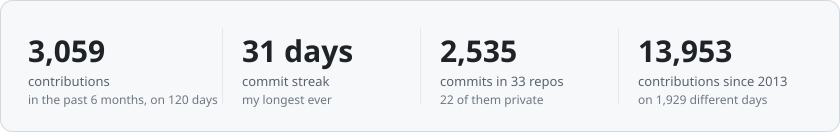
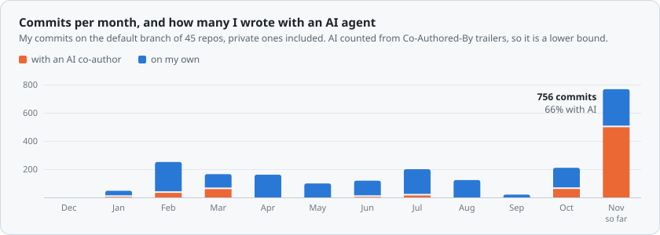
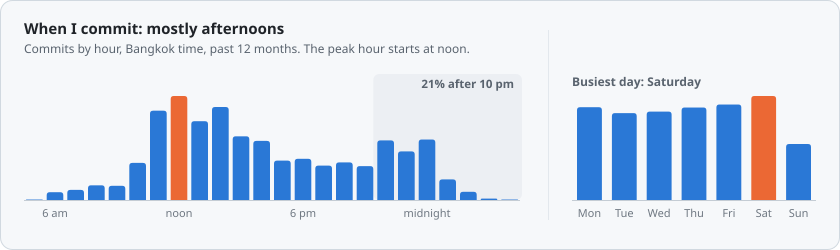
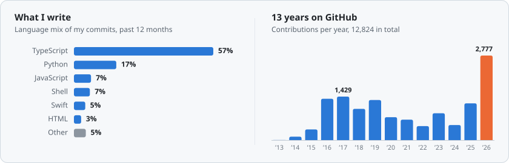

<picture>
  <source media="(prefers-color-scheme: dark)" srcset="assets/hero-dark.svg">
  
</picture>

### Olá mundo, this is Lucas!

I'm a full-stack developer living in Bangkok. I've been writing software since 2012 and pushing it here since 2013, mostly TypeScript these days, with a growing side of Python and Swift.

- Most of my time goes into the businesses I built with my best friends.
- The rest goes into my own ideas. AI coding agents made it much faster to build something and find out if it works, and my commit graph shows it.
- I still have to remind myself to go outside, exercise and make new friends. All that jazz matters too.

### What I'm building

- [**ThaiLookup**](https://thailookup.com) · instant Thai translation, romanization and tone breakdowns for any word, with decks to review them. I'm learning Thai myself.
- [**agent-ready-repo**](https://github.com/lnmunhoz/agent-ready-repo) · a project template coding agents can find their way around: feature folders, specs, a changelog and checks that keep them current.
- [**macros.lnmunhoz.dev**](https://macros.lnmunhoz.dev) · what I eat, as a public dashboard of my daily macros.

### My year in commits

<picture>
  <source media="(prefers-color-scheme: dark)" srcset="assets/numbers-dark.svg">
  
</picture>

<picture>
  <source media="(prefers-color-scheme: dark)" srcset="assets/pairing-dark.svg">
  
</picture>

<picture>
  <source media="(prefers-color-scheme: dark)" srcset="assets/rhythm-dark.svg">
  
</picture>

<picture>
  <source media="(prefers-color-scheme: dark)" srcset="assets/craft-dark.svg">
  
</picture>

<!-- updated:start -->
Updated 14 Nov 2026 by a GitHub Action. Private repos count only as totals: no names, no code.
<!-- updated:end -->

### Lately in public

<!-- public:start -->
- [**macros-dashboard-site**](https://github.com/lnmunhoz/macros-dashboard-site) · Static build for macros.lnmunhoz.dev (aggregates only) HTML · Nov 2026
- [**agent-ready-repo**](https://github.com/lnmunhoz/agent-ready-repo) · A project template that coding agents can find their way around: feature folders, specs, a changelog, a task list and checks that keep them current. JavaScript · Nov 2026
- [**pgcop**](https://github.com/lnmunhoz/pgcop) TypeScript · Aug 2026
- [**mongocop**](https://github.com/lnmunhoz/mongocop) · Interactive CLI tool for copying MongoDB databases. TypeScript · Jul 2026
- [**skills**](https://github.com/lnmunhoz/skills) · My skills directory Jun 2026
<!-- public:end -->

### Find me

[lnmunhoz.dev](https://lnmunhoz.dev) · [@lnmunhoz on X](https://x.com/lnmunhoz)

The cards above draw themselves from my GitHub activity. [How they work](profile/README.md).
